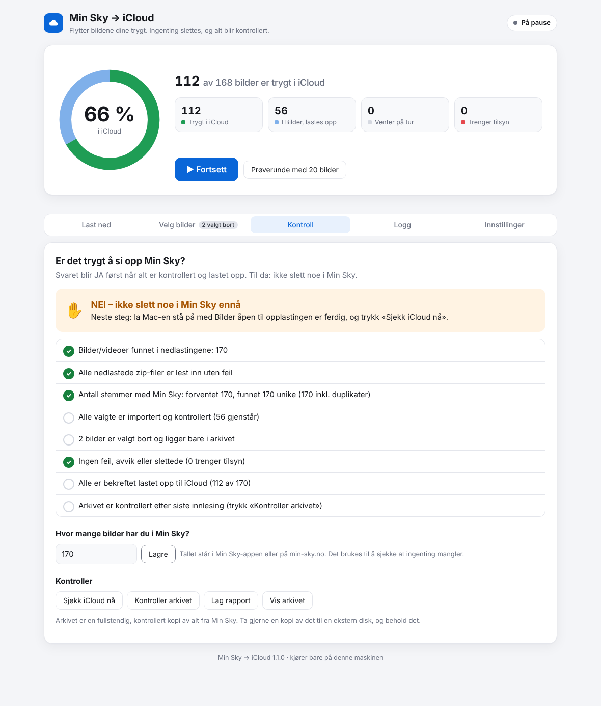

# Min Sky → iCloud

Et verktøy som flytter alle bilder og videoer fra **Telenor Min Sky** til **iCloud-bilder**,
og som er laget for at **ingenting skal kunne gå tapt** underveis, selv om det stopper midt i.

```
 Min Sky (nett)            Mac-en din                                       iCloud
┌──────────────┐  zip   ┌─────────┐  kontroll  ┌────────┐ import ┌────────┐ Apple  ┌────────┐
│ min-sky.no   │ ─────▶ │ innboks │ ─────────▶ │ arkiv  │ ─────▶ │ Bilder │ ─────▶ │ iCloud │
└──────────────┘        └─────────┘  SHA-256   └────────┘        └────────┘        └────────┘
     urørt                  urørt      permanent kopi       kontrollert mot arkivet   bekreftet
```

## Slik er det sikret at ingenting blir borte

| Risiko | Hva verktøyet gjør |
|---|---|
| Strømmen går, Mac-en sovner, du trykker Ctrl+C | Alt som er gjort, er skrevet i en database (`flytting.db`) i det øyeblikket det skjer. Kjør samme kommando igjen, så fortsetter det der det slapp. |
| En nedlasting fra Min Sky ble avbrutt eller er skadet | Hver fil i zip-filen kontrolleres med sjekksummen (CRC) som ligger i zip-filen. Ødelagte zip-filer får beskjed «last ned på nytt». Det som var i orden, beholdes. |
| Filen blir skrevet feil til disk | Hver fil skrives til en midlertidig fil og lagres skikkelig på disken. Den leses så inn igjen, og SHA-256-sjekksummen sammenlignes før den regnes som arkivert. |
| Samme bilde lastet ned flere ganger (album + «alle bilder») | Gjenkjennes på innhold (SHA-256) og lagres bare én gang. Alle steder bildet ble funnet, huskes. **Du kan trygt laste ned for mye.** |
| Stopp midt i en import til Bilder | Neste kjøring importerer gruppen på nytt med duplikatsjekk. Det som allerede kom inn, kobles til bildet som finnes, og blir ikke lagt inn to ganger. |
| Bildet fantes allerede i iCloud (f.eks. fra iPhone) | Det legges ikke inn på nytt. Er kopien i iCloud *ikke* helt identisk, importeres Min Sky-kopien i tillegg. Et duplikat er bedre enn et tap. |
| Bilder-appen tok ikke imot filen riktig | Etter import slås hvert bilde opp i Bilder-biblioteket og sammenlignes byte for byte (SHA-256) med arkivet. |
| Det er ikke lastet opp til iCloud ennå | Bilder-appen spørres om hvert enkelt bilde faktisk er lastet opp. Først da står det «FERDIG». |
| Noen sletter et bilde i Bilder etterpå | `verifiser` oppdager det. Slettede bilder importeres på nytt, og bilder i «Nylig slettet» flagges. |
| Disken blir full | Ledig plass sjekkes før hver zip-fil og hver importgruppe, og verktøyet stopper i god tid. |
| Arkivet blir skadet over tid | `kontroller-arkiv` leser alt på nytt og sjekker sjekksummene. Skadde filer repareres fra zip-filen. |
| To vinduer kjører samtidig | En lås hindrer det. |

Verktøyet **sletter aldri noe**, verken i Min Sky, i innboksen eller i Bilder.
Arkivmappen blir din fullstendige, kontrollerte sikkerhetskopi.

Til slutt får du en sjekkliste som svarer **JA** eller **NEI** på om det er trygt å si opp Min Sky.

---

## Kom i gang (Mac)

1. Last ned dette prosjektet som zip fra GitHub (grønn «Code»-knapp → «Download ZIP») og pakk det ut.
2. Dobbeltklikk **`scripts/Installer.command`**. Svarer macOS at filen ikke kan åpnes, høyreklikker du den og velger
   **Åpne**. Installasjonen tar seg av alt (Homebrew, osxphotos og programmet) og legger en snarvei
   **«Min Sky til iCloud»** på skrivebordet.
3. Systeminnstillinger → Personvern og sikkerhet → **Full disktilgang** → slå på **Terminal**.
4. I Bilder-appen: Innstillinger → iCloud → slå på **iCloud-bilder**. Sjekk at iCloud-abonnementet har plass nok.

Senere starter du programmet ved å dobbeltklikke snarveien. Det åpnes i nettleseren og kjører bare på din egen maskin.



## Slik bruker du det

1. **Innstillinger**: Har du mange bilder, velger du en ekstern disk til arkivet først (se «Diskplass» under).
2. **Last ned**: Slå på «Hent Min Sky-nedlastinger automatisk». Åpne min-sky.no i Chrome og last ned ett album
   eller én bunke om gangen. Zip-filene hentes selv fra Nedlastinger-mappen og kontrolleres.
3. **Prøverunde med 20 bilder**: Se etter albumet «Fra Min Sky» i Bilder og sjekk at alt ser riktig ut.
4. **Start**: Autopiloten legger bildene inn i Bilder, kontrollerer dem og sjekker iCloud-opplastingen. Den fortsetter
   så lenge du lar den gå. **Du kan fortsette å laste ned fra Min Sky mens den jobber**, og nye zip-filer blir
   tatt med automatisk. Mac-en holdes våken, og du får et varsel når alt er ferdig eller noe trenger tilsyn.
5. **Velg bilder** (valgfritt): Fjern haken på mapper eller enkeltbilder du ikke vil ha med.
6. **Kontroll**: Skriv inn hvor mange bilder Min Sky sier du har. Når sjekklisten sier **JA**, er alt trygt i iCloud.

«Sett på pause» stopper ved neste trygge punkt, og «Fortsett» tar opp tråden. Lukker du vinduet eller går strømmen,
fortsetter du bare ved å starte igjen. Ingenting går tapt, og ingenting blir lagt inn to ganger.

## Hvor lang tid tar det? (eksempel: 20 000 bilder)

Tallene er grove anslag. Det meste avhenger av nettet ditt og Mac-en.

| Del | Omtrent | Hva du gjør |
|---|---|---|
| Laste ned fra Min Sky (ca. 60–100 GB) | 2–4 timer på 100 Mbit/s | Klikk «Last ned» per album. Resten går av seg selv |
| Lese inn og kontrollere | går **mens** du laster ned | ingenting |
| Legge inn i Bilder | noen timer | ingenting, la Mac-en stå |
| Bilder laster opp til iCloud | flere timer (avhenger av opplastingshastigheten din) | la Mac-en stå på over natten |
| Kontroll | noen minutter | trykk «Kontroller arkivet» til slutt |

Det som sparer tid i programmet:
* **Alt overlapper.** Programmet leser inn og importerer mens du laster ned neste album, i stedet for at du venter
  på hvert steg.
* **Bilder legges inn 500 om gangen.** Bilder-appens database klargjøres én gang per runde, ikke for hvert lille parti.
* **Mac-en holdes våken**, så en natt med opplasting ikke stopper fordi maskinen sovnet.
* **Du slipper manuell kontroll** av 20 000 bilder. Sjekklisten gjør det for deg.
* **Duplikater** (samme bilde i flere album) blir lest inn og lagt inn i Bilder bare én gang.

## Diskplass

Med 20 000 bilder trenger du plass til zip-filene, arkivet og Bilder-biblioteket, altså opptil 3 × størrelsen på bildene.
* Legg **arkivet på en ekstern disk** (Innstillinger → «Hvor skal arkivet ligge?»).
* Trykk **«Frigjør … : slett ferdige zip-filer»** under Last ned. Det slettes bare zip-filer der hver eneste fil er
  kontrollert og ligger i arkivet. Originalene ligger fortsatt i Min Sky.
* Slå på **«Optimaliser Mac-lagring»** i Bilder → Innstillinger → iCloud. Da sletter Bilder de lokale originalene
  etter at de er lastet opp til iCloud.

Programmet varsler deg i god tid hvis plassen blir for liten, og stopper før disken blir full.

## Hvorfor HEIC går via Bilder-appen

iCloud sin nettside (iCloud.com) og alle «direkte» iCloud-integrasjoner bruker Apples web-opplasting, og den tar
**bare imot JPEG**. HEIC-bilder (iPhone-standarden), videoer og Live Photos blir avvist. Bilder-appen på Mac tar imot
alt dette i original kvalitet, og laster det opp til iCloud selv. Derfor går programmet via Bilder-appen.

## Bruke Terminal i stedet

Alt programmet gjør, kan også gjøres fra Terminal, med de samme sikkerhetene:

```bash
minsky-icloud kjør
```

```bash
minsky-icloud status
```


## Alle kommandoer

| Kommando | Hva den gjør |
|---|---|
| `minsky-icloud app` | Åpner programmet (det samme som snarveien) |
| `minsky-icloud snarvei` | Lager snarvei på skrivebordet |
| `minsky-icloud sjekk` | Sjekker Mac, osxphotos og diskplass |
| `minsky-icloud hent` | Leser inn og kontrollerer nedlastinger og arkiverer dem (fungerer også på Windows/Linux) |
| `minsky-icloud importer [--antall N]` | Legger arkiverte bilder inn i Bilder-appen |
| `minsky-icloud verifiser [--alle]` | Kontrollerer bildene i Bilder og iCloud-opplastingen |
| `minsky-icloud kjør [--antall N]` | hent → importer → verifiser → status |
| `minsky-icloud status` | Viser fremdrift og sjekklisten |
| `minsky-icloud rapport` | Lager en HTML- og CSV-rapport over alle filer |
| `minsky-icloud forventet N` | Registrerer antallet bilder Min Sky viser |
| `minsky-icloud kontroller-arkiv` | Leser hele arkivet på nytt og sjekker sjekksummene |

Valg: `--mappe STI` (arbeidsmappe), `--album NAVN` (standard «Fra Min Sky», `--album ""` for intet album),
`--gruppe N` (filer per importrunde), `--prøv-feil-igjen`, `-v` (mer detaljer).

## Mappen

```
~/MinSky-flytting/
  innboks/       ← legg nedlastingene her (blir aldri endret)
  arkiv/         ← kontrollert kopi av hver fil, med mappestrukturen fra Min Sky
  rapporter/     ← HTML/CSV-rapporter
  logg/          ← logg over alt som skjer, og rådata fra hver import
  flytting.db    ← databasen med status for hver fil
```

Når `status` sier **JA** og du har tatt en kopi av `arkiv/`, kan du slette `innboks/` for å frigjøre plass.

## Hva betyr statusene?

| Status | Betydning |
|---|---|
| `arkivert` | Trygt kopiert og kontrollert lokalt, venter på import |
| `importerer` | Import påbegynt, fullføres ved neste kjøring |
| `importert` | Ligger i Bilder, ikke kontrollert ennå |
| `bekreftet` | Kopien i Bilder er identisk med arkivet, venter på iCloud-opplasting |
| `i_icloud` | **Ferdig**: kontrollert og lastet opp til iCloud |
| `ikke_media` | Ikke bilde eller video (ligger bare i arkivet) |
| `feil` | Bilder-appen avviste filen 3 ganger. Filen ligger i arkivet og vises i rapporten |
| `avvik` | Kopien i Bilder stemmer ikke med arkivet. Må sjekkes manuelt |
| `i_papirkurv` | Ligger i «Nylig slettet» i Bilder. Gjenopprett den der og kjør `verifiser` |

## Feilsøking

* **«Fant ikke osxphotos»**: Kjør `pipx install osxphotos` og åpne Terminal på nytt.
* **Bilder-appen spør om noe eller henger**: Svar på dialogen. Henger den, avslutter du Bilder og kjører
  `minsky-icloud kjør` igjen.
* **«feil» på noen videoer**: Noen gamle formater (`.avi`, `.wmv`, `.mkv`) støttes ikke av Bilder. De ligger i arkivet.
  Konverter dem (f.eks. med HandBrake) og legg de konverterte filene i innboksen.
* **Datoene er feil på noen bilder**: Bilder uten opptaksdato i filen (typisk fra meldingsapper) får datoen
  som ligger i zip-filen. Den kan rettes i Bilder → Bilde → Juster dato og tid.
* **Logg**: `~/MinSky-flytting/logg/minsky-icloud.log`

## Hvorfor ikke innlogging med Telenor direkte i programmet?

Min Sky (nå drevet av Jottacloud) har ingen offentlig API. En innlogging rett i programmet krever at
nettsidens interne API kartlegges, og det er planlagt som neste steg (se `docs/telenor-innlogging.md`).
Uansett må bildene innom maskinen din: verken Telenor eller Apple kan sende bilder direkte seg imellom.
Det som tar tid, er nedlasting og opplasting over nettet. Den lokale kopien koster litt diskplass, men nesten
ingen tid, og den er sikkerhetsnettet ditt hvis noe går galt.

## For utviklere

```bash
python3 -m pip install pytest && python3 -m pytest
```

Testene bruker en falsk `osxphotos` (`tests/fake_osxphotos.py`) og kjører på Linux og Mac. De simulerer blant annet
krasj under utpakking og import, avbrutte nedlastinger, CRC-feil, bilder som finnes fra før, bilder som er slettet
i Bilder, og skadet arkiv.
